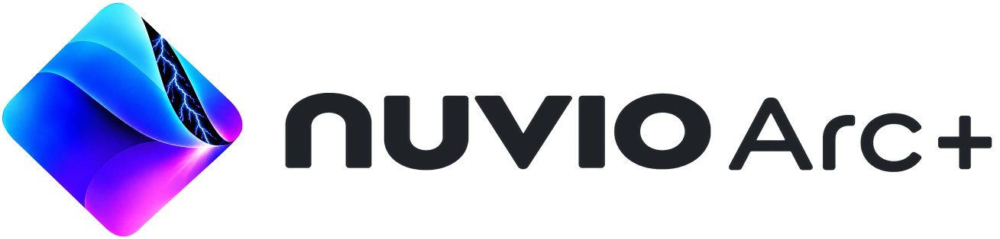

  <picture>
    <source media="(prefers-color-scheme: dark)" srcset="docs/readme/arcplus-wordmark-white.png">
    
  </picture>

  <a href="#built-on"><b>Built on</b></a> &nbsp;·&nbsp;
  <a href="#what-arc-adds"><b>What Arc+ adds</b></a> &nbsp;·&nbsp;
  <a href="#getting-it"><b>Getting it</b></a> &nbsp;·&nbsp;
  <a href="#license"><b>License</b></a>

**Nuvio Arc+** is my personal build of [**Nuvio Arc**](https://github.com/ysosrs123/NuvioTV-Fork) by
**ysosrs123**, which is itself built on [**NuvioTV**](https://github.com/NuvioMedia/NuvioTV) by the
Nuvio team. It follows every Arc release and adds a set of changes on top, made and tested on my own TVs.
The name is used with ysosrs123's blessing.

Almost everything in this app is their work. Arc+ is a small layer on top: it keeps all of Arc and adds
the changes listed below.

## Built on

<table>
<tr>
<td width="50%" valign="top"><b><a href="https://github.com/NuvioMedia/NuvioTV">NuvioTV</a></b> The Android TV media player at the heart of it all, by the Nuvio team and its contributors. If you
enjoy any of this, please support them at <a href="https://nuvio.tv/support">nuvio.tv/support</a>.</td>
<td width="50%" valign="top"><b><a href="https://github.com/ysosrs123/NuvioTV-Fork">Nuvio Arc</a></b> by ysosrs123 Scout, the surround engine, seek thumbnails, media servers, the Calendar, the stats panel and much
more. See <a href="docs/FEATURES.md">Arc's full feature list</a>.</td>
</tr>
</table>

## What Arc+ adds

The full list, with the details behind each change, is in **[FORK-CHANGES.md](FORK-CHANGES.md)**.

### Player

- **Media info line on the OSD.** A pill at the top left shows resolution, HDR and audio (codec, Atmos,
  channels, and whether sound goes out as Passthrough or PCM), drawn with your badge pack. It's ready the
  moment the OSD opens.
- **Badges read from the stream itself, never the file name.** HDR10+ comes from the decoder's metadata,
  TrueHD Atmos from the TrueHD bitstream, and DTS-HD, DTS-HD MA and DTS:X from the DTS extension
  headers. Release names often list several tracks, so they gave the wrong badges.
- **Atmos before the codec**, a Mono badge for single-channel audio, and badge artwork that's no longer
  clipped at the corners.
- **Clock pills**: the time, and when the film ends, on Home, the details page and the OSD.
- **Hybrid button style** for custom player layouts (labels on the left and centre, icons on the
  right), and the controls always come back on Play/Pause.

### Home and Continue Watching

- **Recently Watched row**, newest first, from whichever service holds your watch progress: Nuvio Sync,
  Trakt, Simkl, MDBList or WeTrakr.
- **Drop show** in the Continue Watching long-press menu. It marks the show Dropped on every connected
  tracker (Trakt, Simkl, MDBList and WeTrakr) and keeps your history and library.
- **Series and Movies in separate rows**, and a **Last aired** sort.

### Details page

- **Progress bar on the Resume button**, in your theme colour.
- **Reset progress** in the long-press menus for a film or an episode.
- **TMDB reviews** as an alternative to Trakt.

### Under the hood

- **Lighter on weak boxes.** Big artwork is kept at display size, and source searches take turns while
  a video plays. Image decodes on a Box R 4K Plus dropped from up to 930 ms to under 360 ms.
- **One next-episode lookahead**, 4 minutes before the end, so the next episode's sources are fresh.
- **MDBList ratings cached for a week**, so a free MDBList key lasts across several TVs.
- **Settings search** finds all of the above.

### Badge packs

Matching **AAC, MP3, Mono, Stereo, PCM and Passthrough** badges for the Elite-Badges style, and a
**Neon** pack based on FR-Badges with a matching Passthrough badge, in
[jsaxon2/nuvio-badges](https://github.com/jsaxon2/nuvio-badges).

## Getting it

Arc+ installs next to the official Nuvio and Nuvio Arc under its own app id, and tells you when a new
Arc+ release is out (Settings > About).

| Your box | Direct download |
|---|---|
| **32-bit:** Fire TV Stick, Chromecast with Google TV, Box R, Shield tube and many other Google TV boxes | [32-bit APK](https://github.com/jsaxon2/Nuvio-Arc-Plus/releases/latest/download/app-full-armeabi-v7a-release.apk) |
| **64-bit:** Nvidia Shield 2017 and Pro, Ugoos | [64-bit APK](https://github.com/jsaxon2/Nuvio-Arc-Plus/releases/latest/download/app-full-arm64-v8a-release.apk) |

1. Install **Downloader** by AFTVnews from your box's app store, and allow it to install unknown apps.
2. In Downloader, enter the download link for your box and press Go.
3. Press Install when the download finishes.

Not sure which one? Many boxes run a 32-bit system even with a 64-bit chip. Try 64-bit first. If it says
the app isn't compatible, use 32-bit. All releases are on the [Releases page](https://github.com/jsaxon2/Nuvio-Arc-Plus/releases).

Arc+ is a personal project: it follows Arc a little behind each release, and has no support or issue
reporting. The code lives on three branches:

| Branch | What it holds |
|---|---|
| `my-main` | The main changes, plus this build's name, icons and app id |
| `my-extras` | Player and details-page changes |
| `try-perf` | Performance changes, on top of both (the default branch) |

**Please don't report problems with Arc+ to Nuvio Arc or to the official Nuvio GitHub or Discord.**
They can't help with changes they didn't make.

## Disclaimer

Nuvio Arc+ is a media player and library browser. It comes with no films, shows, channels, streams or
add-ons, and nothing here hosts, provides or links to any content. Everything it plays comes from sources
you connect yourself, and you're responsible for making sure you're allowed to play them. Service names
and logos belong to their owners. Arc+ is not affiliated with or endorsed by the NuvioTV project or any
service it connects to. This product uses the TMDB API but is not endorsed or certified by TMDB. It is
provided as is, without warranty of any kind.

## License

This is a modified version of [Nuvio Arc](https://github.com/ysosrs123/NuvioTV-Fork), which is a
modified version of [NuvioTV](https://github.com/NuvioMedia/NuvioTV). Both are licensed under the
[GNU General Public License v3.0](./LICENSE), and so is this. Every Arc+ change is in this repository's
history on top of the Arc release it builds on. All upstream copyright notices, license headers and author
attributions are kept. Full credit to the NuvioTV maintainers and contributors, and to ysosrs123.

Parts from other projects keep their own licenses:
- TrueHD MAT packing and the downmix path: ported from Kodi (GPL-2.0-or-later), see
  `ffmpeg-decoder-downmix/NOTICE.md`.
- Audio passthrough engine: official pull request 3107 by halibiram, with ram130. Media servers:
  official pull request 3728 by tapframe.
- FFmpeg (LGPL-2.1-or-later): audio decoder built from FFmpeg 7.0.2, recipe in
  `.github/workflows/build-ffmpeg-decoder.yml`; headers only under `app/src/main/cpp/third_party/`.
- dav1d by VideoLAN and the dav1d authors (BSD-2-Clause) for software AV1 decoding, with
  cpu_features by Google (Apache-2.0).
- libdovi by quietvoid (MIT). Matroska extractor files from AndroidX Media3 (Apache-2.0), changed.
- Release group lists from TRaSH Guides (MIT).
- Fonts Atkinson Hyperlegible Next, Source Sans 3, and the subtitle fonts Roboto, Montserrat, Noto Sans
  and Asap Condensed (SIL Open Font License 1.1, texts in `app/src/main/assets/licenses/`).
- Watch party avatars: made with DiceBear and Twemoji, under CC BY 4.0, CC0 1.0 and the Bottts terms.
  They are credited in the app under Settings > About > Licenses & attribution and are not covered by
  the GPL.
- Calendar episode times come from TVmaze's schedule service and TheTVDB (metadata provided by
  TheTVDB), credited in the app under Settings > About > Licenses & attribution.
- The Neon badge pack is based on FR-Badges by farizmohd70 (MIT).
- Other service logos and names belong to their owners and only show which service the app connects to.
- Prebuilt libraries that come unchanged from the official app are covered by the official project's
  sources and notices.
